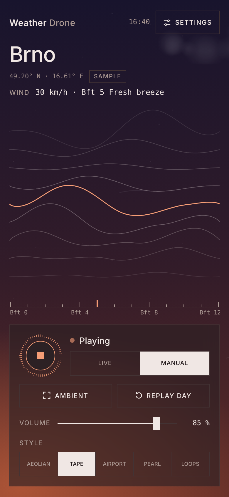
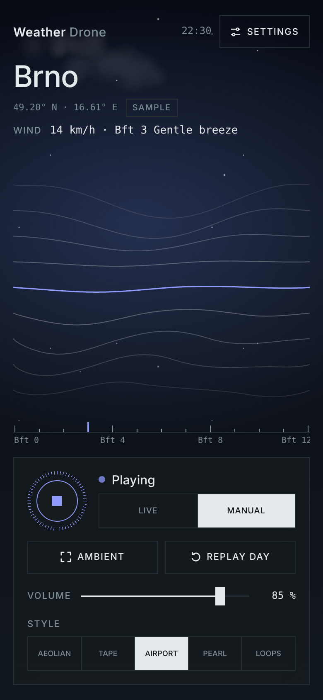
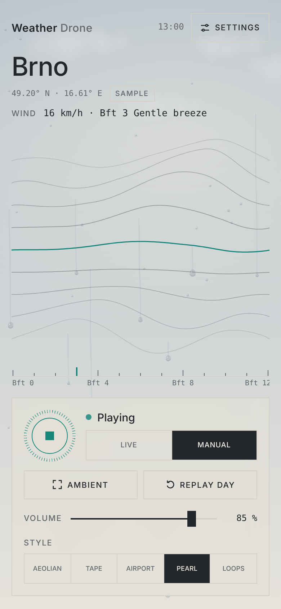
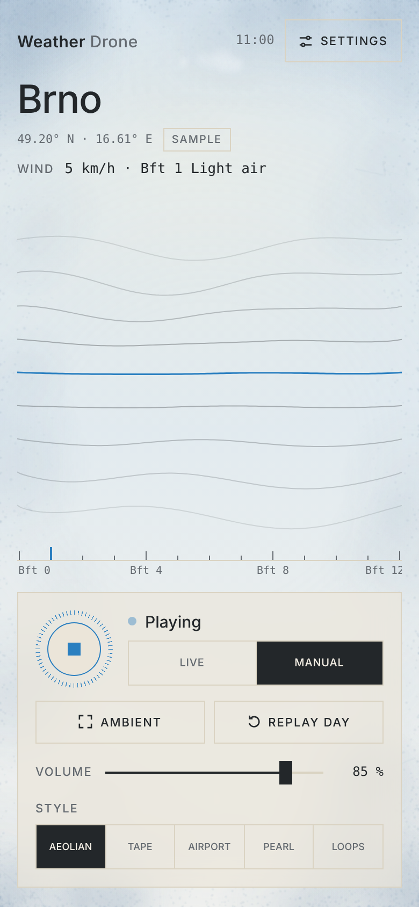
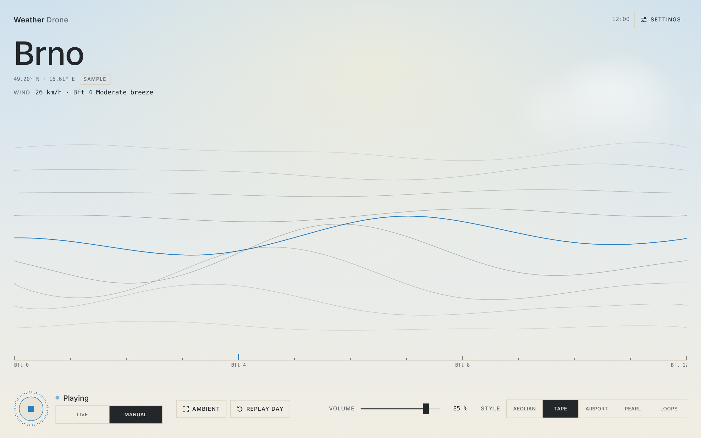

# Weather Drone

A generative ambient instrument for the browser, played by the live weather where you are. Wind, rain, pressure and temperature shape the sound; the sky on screen follows the real sun and shows the same weather.

**▶ Listen:** https://shoogaze.github.io/weather-drone/

- **Live**: your location and the Open-Meteo forecast, refreshed every 10 minutes
- **Manual**: sliders for temperature, wind, rain, cloud cover, humidity, pressure and time of day
- **Styles**: five ways to play the weather (Aeolian drone, Tape loops, Airport phase loops, Pearl piano, decaying Loops)
- **Sky**: night, dawn, day and dusk; clouds, drops on the glass, snow, frost, fog, heat haze, gusts and storms
- **Replay day**: the last 24 hours in 5, 10 or 20 minutes, sound and sky together
- **Ambient**: a full-screen screensaver with only the waves, the city and the sound
- **Installable**: add it to the Home Screen; it starts offline and keeps playing in manual mode

Sleep timer · Character macro · animation level (full / calm / off) · 11 languages · phone, tablet and desktop layouts.

Keys: `Space` play / stop, `M` live / manual, `F` ambient, `D` replay day, `S` settings.

## Screenshots

| Dusk | Night | Rain | Frost |
|:---:|:---:|:---:|:---:|
|  |  |  |  |

## Run

Open `index.html` in a browser. No build step, no dependencies. For GitHub Pages: Settings → Pages → deploy from branch `main`, root.

**Install on iPhone:** open the site in Safari → Share → Add to Home Screen. Keep `css/`, `js/`, `icons/`, `manifest.webmanifest` and `sw.js` next to `index.html`.

Live mode needs HTTPS and location access. Coordinates go only to [Open-Meteo](https://open-meteo.com/) (weather, CC BY 4.0) and [BigDataCloud](https://www.bigdatacloud.com/) (city name). Sound is synthesised in the browser and never recorded.

## License

[MIT](LICENSE) © 2026 Kirill Kinderhart
