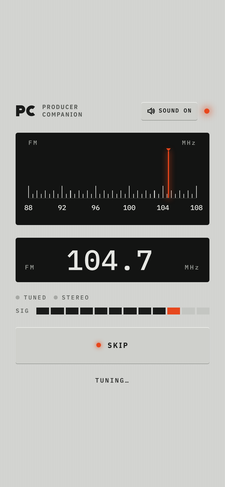
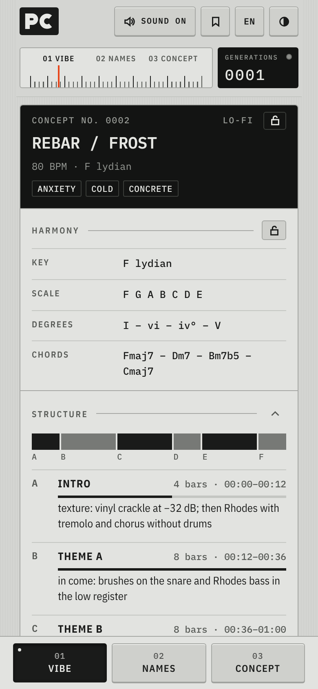
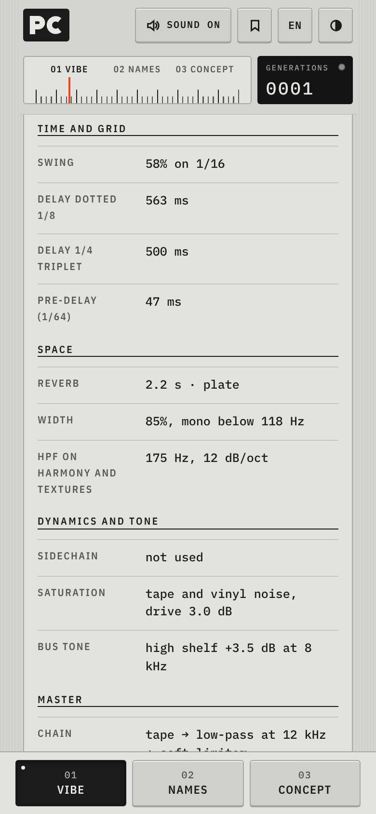
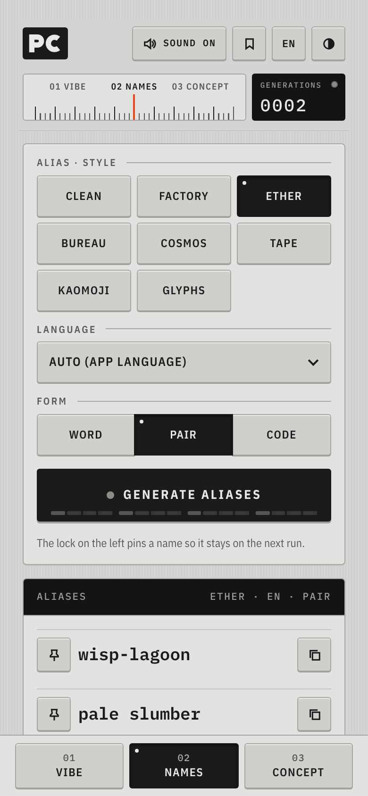
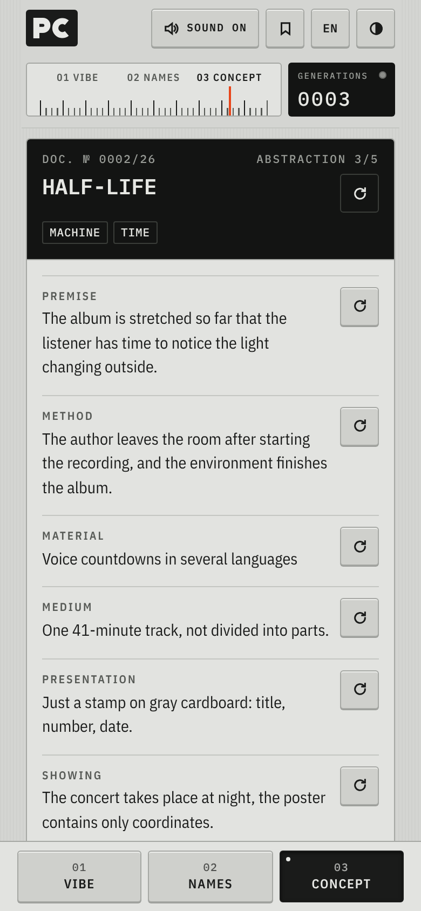
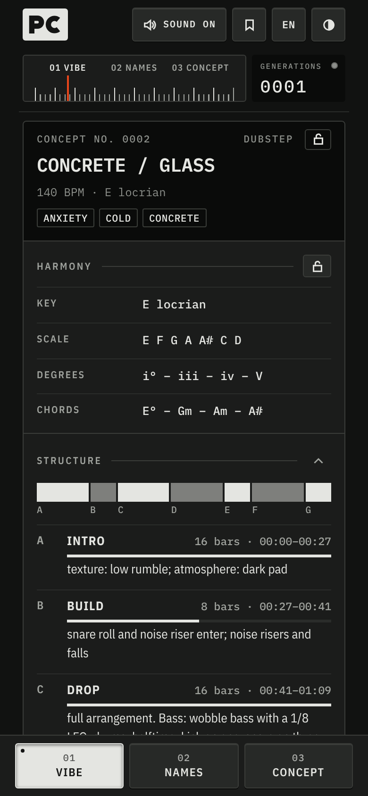
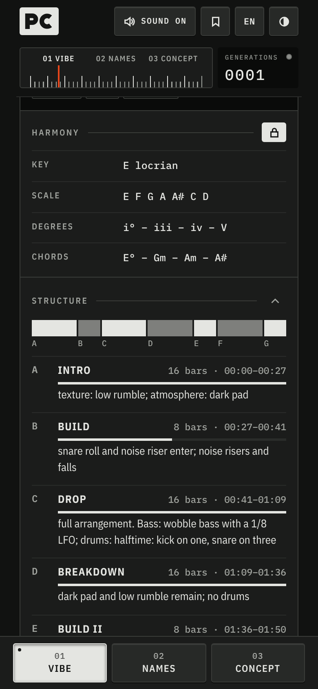
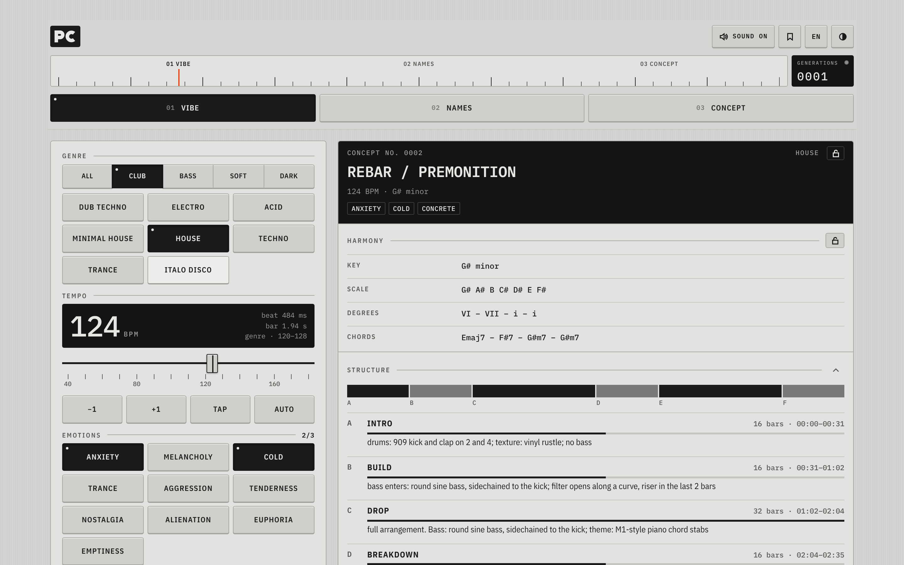

# Producer Companion

A single-file mobile web app for electronic music producers, styled after Braun notebooks and vintage measuring instruments: monochrome, one orange lamp, IBM Plex type, a radio-dial boot screen.

<!-- Demo: in the GitHub editor, drag extras/demo.mp4 here; it is uploaded and plays inline. -->

- **Vibe**: genre, tempo, emotions and aesthetic → track concept with structure, instruments and mixing parameters
- **Names**: stage aliases and tracklists in eight styles (Clean, Factory, Ether, Bureau, Cosmos, Tape, Kaomoji, Glyphs) and seven languages (RU, EN, ES, DE, FR, JA, ZH, or mixed), thousands of word combinations
- **Concept**: conceptual / industrial album ideas
- **Locks**: pin the harmony, the instruments or the title in a Vibe result and regenerate the rest
- **Saved**: keep any result on the device (bookmark button in the header), copy or delete it later
- **Installable**: add to the Home Screen and it works offline (PWA)

28 genres · interface in RU / EN / ES / DE / FR / JA · light, grey and dark skins · radio-dial boot screen with Web Audio sounds · phone, tablet and desktop layouts.

Keys: `1`–`3` switch modules, `G` generate, `M` toggle sound.

## Screenshots

| Boot | Vibe | Mix | Names |
|---|---|---|---|
|  |  |  |  |

| Concept | Dark skin | Locks |
|---|---|---|
|  |  |  |

**Desktop**

## Run

Open `index.html` in a browser. No build step. For GitHub Pages: Settings → Pages → deploy from branch `main`, root.

**Install on iPhone:** open the site in Safari → Share → Add to Home Screen. It then runs full-screen and offline. Keep `manifest.webmanifest`, `sw.js` and the `icons/` folder next to `index.html`.

## License

[MIT](LICENSE) © 2026 Kirill Kinderhart
