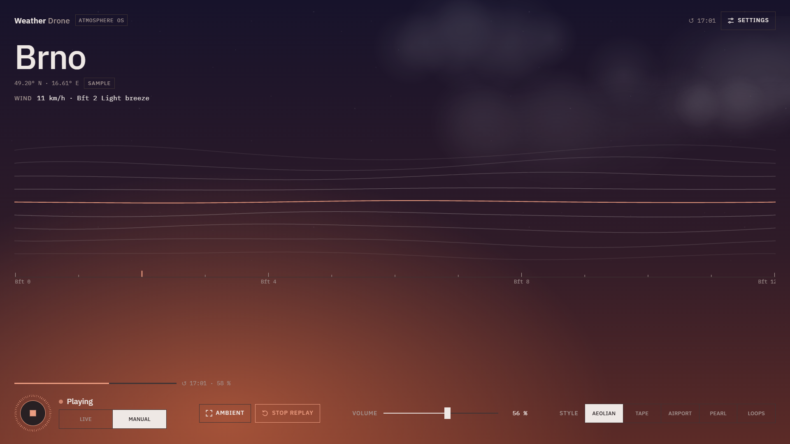

# Weather Drone · Atmosphere OS

**Weather becomes sound.** A generative ambient drone driven by the live weather where you are.
Wind, rain, pressure, humidity, temperature and the position of the sun shape both the music and the sky on screen.

**▶ Listen:** [https://SHOOGAZE.github.io/weather-drone/](https://SHOOGAZE.github.io/weather-drone/)



One HTML file. No sign-up, no API keys, no tracking, no build step.

## What you hear

| Weather | Sound |
|---|---|
| Temperature | register of the whole drone |
| Time of day | the scale: bright major by day, calm Egyptian pentatonic at night |
| Wind (Beaufort scale) | gusting wind noise, an Aeolian harp that sings on the gusts, how far the filter wanders |
| Rain | soft hiss and tiny drops; snow mutes them into a hush |
| Storm (Bft 8+) | distant thunder |
| Humidity | size of the reverb and width of the chorus |
| Pressure | how slowly the drone breathes, weight of the sub-octave |
| Cloud cover | how open the filter is, how many notes the motifs play |

The sky behind the interface follows the real sun: night with stars, dawn, a cream-coloured day, a golden evening, dusk. Clouds, rain, snow, wind, fog, heat haze and frost are drawn from the same weather data.

## Five styles

- **Aeolian:** a free-floating triangle-wave drone with slow glides.
- **Tape:** a looping four-chord progression, a music-box motif, wow & flutter, saturation and tape echo.
- **Airport:** seven piano and voice loops of different lengths, so their combinations never repeat.
- **Pearl:** sparse piano chords in a long, pedalled haze.
- **Loops:** a short phrase that slowly wears out, loop after loop, until a new one is born.

These are homages to classic ambient techniques. They are not affiliated with any artist.

## Features

- **Live mode:** uses your location and the Open-Meteo forecast, refreshed every 10 minutes.
- **Manual mode:** a sample city (Brno) with sliders for every parameter.
- **Day replay:** the last 24 hours played back in 5, 10 or 20 minutes. Sound and sky go from night to dawn to day to dusk.
- **Ambient mode:** a full-screen screensaver with only the waves, the city and the playback state.
- **Other settings:**
  - sleep timer;
  - "Character" macro (darker ↔ brighter);
  - animation level (Full / Calm / Off);
  - 11 languages.
- **Hotkeys:** `Space` play/stop · `M` live/manual · `F` ambient · `D` day replay · `S` settings.

## Privacy

Your coordinates are sent only to two services:
- [Open-Meteo](https://open-meteo.com/) for the weather;
- [BigDataCloud](https://www.bigdatacloud.com/) for the city name.

Sound is synthesised in your browser with the Web Audio API and is never recorded. Only your volume, language and display preferences are stored, in your own browser.

## Run it locally

Just open `index.html`. For live mode the browser needs a secure origin, so serve it locally:

```bash
python3 -m http.server 8000
# then open http://localhost:8000
```

## Deploy on GitHub Pages

1. Push `index.html`, `preview.png`, `README.md` and `LICENSE` to a repository.
2. Go to **Settings → Pages → Deploy from a branch → `main` / root**.
3. In `index.html`, replace `og:image` with the absolute URL, e.g. `https://YOUR-NAME.github.io/weather-drone/preview.png`. This makes link previews show the image.

## Credits

- Weather data by [Open-Meteo](https://open-meteo.com/) (CC BY 4.0).
- Reverse geocoding by [BigDataCloud](https://www.bigdatacloud.com/).
- Typeface: IBM Plex Sans & Mono.

## License

MIT © 2026 Kirill Kinderhart

---

### По-русски

Генеративный эмбиент-дрон, которым управляет реальная погода. Ветер, дождь, давление, влажность, температура и положение солнца меняют и звук, и небо на экране.

Это один HTML-файл без регистрации и ключей. Есть пять стилей, «Память дня» (сутки за 5–20 минут), эмбиент-режим и 11 языков.
